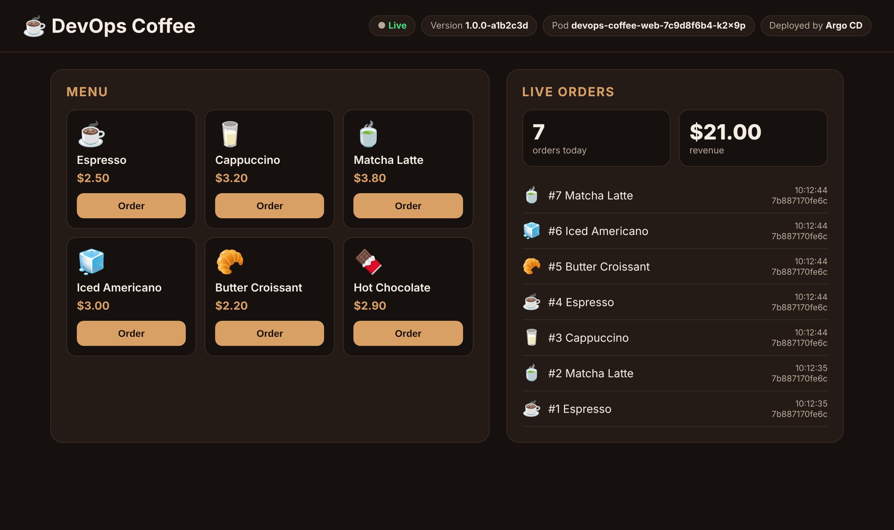

# ☕ DevOps Coffee: GitOps with Argo CD (hands-on)



A real coffee-ordering app (Python + Redis) deployed to Kubernetes with **GitOps**:
**Git is the single source of truth.** You push code, and the app updates itself on the cluster.
Nobody runs `kubectl apply` by hand.

> 🎥 From the **DevOps with Umesh** YouTube channel.

---

## 🧭 How it works

```
  You                     GitHub                                   Your Kubernetes cluster
 ─────                   ────────                                  ───────────────────────
 git push ──────▶  app/ code changes
                        │
                        ▼
              GitHub Actions (CI)
              1. run tests
              2. build Docker image ──────▶ ghcr.io/…/devops-coffee:<sha>
              3. update image tag
                 in k8s/kustomization.yaml
                        │
                        ▼
              k8s/  (desired state)  ◀────── Argo CD (CD) checks Git every 30 s
                                              • sees the new tag
                                              • syncs the cluster to match Git
                                              • undoes any manual changes (self-heal)
                                                        │
                                                        ▼
                                              devops-coffee namespace
                                              ├── web   (2 pods, zero-downtime rollout)
                                              └── redis (orders database)
```

- **CI (GitHub Actions)** builds and tests. It never touches the cluster.
- **CD (Argo CD)** runs *inside* the cluster and **pulls** from Git. No cluster passwords live in GitHub.
- **Rollback = `git revert`.** History, review and audit come for free with Git.

---

## 📁 What's in this repo

```
devops-coffee-gitops/
├── app/                        ← the application
│   ├── app.py                  ← Flask web app + REST API
│   ├── templates/index.html    ← menu + live orders board
│   ├── tests/test_app.py       ← tests run by CI
│   ├── requirements.txt
│   ├── Dockerfile
│   └── VERSION                 ← bump this to release a new version
├── k8s/                        ← desired state (what Argo CD deploys)
│   ├── namespace.yaml
│   ├── redis.yaml
│   ├── web.yaml
│   └── kustomization.yaml      ← image tag, updated by CI automatically
├── argocd/
│   └── application.yaml        ← tells Argo CD: "deploy k8s/ from this repo"
├── .github/workflows/ci.yaml   ← CI: test → build → push → update tag
└── scripts/                    ← helpers for the demo
```

---

## ✅ What you need

| Tool | Check |
|---|---|
| Docker Desktop with **Kubernetes enabled** (Settings → Kubernetes) | `kubectl get nodes` shows `Ready` |
| kubectl pointing at the local cluster | `kubectl config current-context` → `docker-desktop` |
| git + a GitHub account | `git --version` |

Using your own GitHub account? **Fork this repo**, then change `DevOps-with-Umesh` to your
username in `argocd/application.yaml` (the `repoURL`) and `k8s/kustomization.yaml` (`newName`, lowercase).

---

## STEP 1: Get the code and run the first pipeline

```bash
git clone https://github.com/DevOps-with-Umesh/devops-coffee-gitops.git
cd devops-coffee-gitops
chmod +x scripts/*.sh
```

Pushing to `main` (or **Actions → CI – build & release → Run workflow**) starts the pipeline.
Open the **Actions** tab on GitHub and wait for the green ✅ (about 3–5 minutes the first time).

The pipeline:
1. runs the tests
2. builds the image for **Intel and Apple Silicon** and pushes it to `ghcr.io`
3. commits the new image tag into `k8s/kustomization.yaml` (`deploy: devops-coffee 1.0.0-xxxxxxx`)

## STEP 2: Make the image public (one time)

Kubernetes must be able to download the image without a password:

GitHub → your profile/organization → **Packages** → **devops-coffee** → **Package settings** →
*Danger Zone* → **Change visibility → Public**.

## STEP 3: Install Argo CD

```bash
./scripts/install-argocd.sh
```
This installs Argo CD into the `argocd` namespace using the official manifest and sets it to check Git
every **30 seconds** (the default is 3 minutes), which is handy for demos.

Check:
```bash
kubectl get pods -n argocd
```
All pods should be `Running`.

## STEP 4: Open the Argo CD UI

In a **new Terminal tab**:
```bash
./scripts/argocd-ui.sh
```
Open **https://localhost:8443** → the browser warns about the certificate → **Advanced → Proceed**.
Log in with **admin** and the password the script prints.

## STEP 5: Connect Argo CD to GitHub

```bash
./scripts/create-app.sh
```
This applies `argocd/application.yaml`, which tells Argo CD:
*"Watch `k8s/` on the `main` branch of this GitHub repo and keep the `devops-coffee` namespace identical to it."*

In the UI you'll see **devops-coffee** go *OutOfSync → Syncing → **Synced + Healthy*** 💚.
Click it to see the tree: Namespace → Deployments → ReplicaSets → Pods, and Services.

## STEP 6: Open the app

In another **new Terminal tab**:
```bash
./scripts/open-app.sh
```
Open **http://localhost:8090**, order a few coffees, and watch the **Live orders** board.
The header shows the **version** and which **pod** served you.

---

## 🚀 STEP 7: Release a new version, real-time GitOps

**7a.** In another tab, start simulated customers (they order every second):
```bash
./scripts/customers.sh
```

**7b.** Make a change. For example, add a new drink to `MENU` in `app/app.py`:
```python
    {"id": "bubbletea", "emoji": "🧋", "name": "Bubble Tea", "price": 4.20},
```
and bump `app/VERSION` to `1.1.0`.

**7c.** Push it:
```bash
git add app/
git commit -m "Add Bubble Tea to the menu (v1.1.0)"
git push
```

**7d.** Watch it flow:
1. **GitHub → Actions:** tests ✅ → build ✅ → "deploy: devops-coffee 1.1.0-xxxxxxx" commit
2. **Argo CD UI:** within ~30 s the app turns *OutOfSync* → syncs → new pods appear next to the old ones
3. **Browser:** refresh → **Version 1.1.0** and 🧋 **Bubble Tea** is on the menu
4. **customers.sh:** press Ctrl + C → `❌ 0 failed`. **Zero downtime** 🎉

(Impatient? Click **Refresh** on the app in the Argo CD UI to check Git immediately.)

---

## 🛡️ STEP 8: Self-healing, Git always wins

Someone changes the cluster by hand:
```bash
./scripts/drift.sh
```
It scales `web` to **0** pods. Within seconds Argo CD notices the cluster no longer matches Git and
scales it back to **2**. The same happens if someone edits or deletes something with kubectl.

**The lesson:** with GitOps, changes go through Git. Manual changes don't stick.

---

## ⏪ STEP 9: Rollback with git revert

Find the deploy commit made by CI and revert it:
```bash
git pull
git log --oneline -5
git revert --no-edit <sha-of-the-"deploy: devops-coffee 1.1.0-…"-commit>
git push
```
The image tag in `k8s/` goes back to the previous version, so Argo CD rolls back the cluster.
No new build needed, and the rollback is recorded in Git history.

> In the Argo CD UI the *Rollback* button is disabled while auto-sync is on. That's on purpose:
> Git is the source of truth, so you roll back in Git.

---

## 🛟 Troubleshooting

| Problem | Fix |
|---|---|
| Pods show `ImagePullBackOff` | The GHCR package is still private (Step 2), or CI hasn't finished yet |
| Argo CD shows `Unknown` / repo error | The GitHub repo must be **public** (or add it under Settings → Repositories with a token) |
| App doesn't update after a push | Did CI commit the new tag? Check `k8s/kustomization.yaml` on GitHub. Then click **Refresh** in Argo CD |
| CI fails at "git push" | Repo → Settings → Actions → General → **Workflow permissions: Read and write** |
| Browser can't open the app | Is `./scripts/open-app.sh` running? Check `kubectl get pods -n devops-coffee` |
| Forgot the Argo CD password | Run `./scripts/argocd-ui.sh` again, it prints the password |

## 🧹 Clean up
```bash
./scripts/cleanup.sh
```
